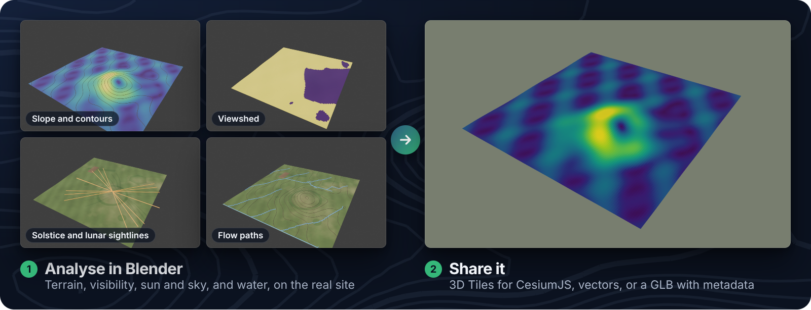
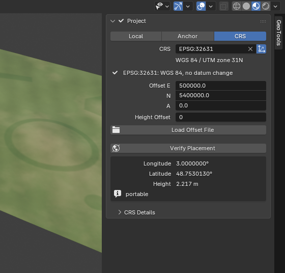
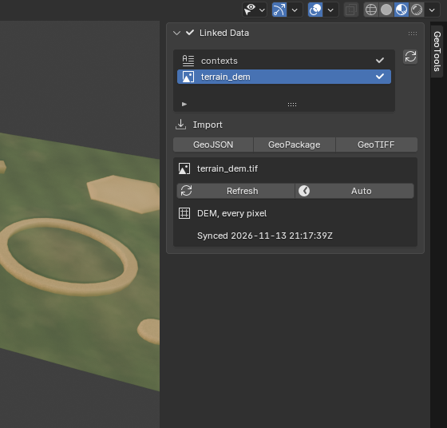
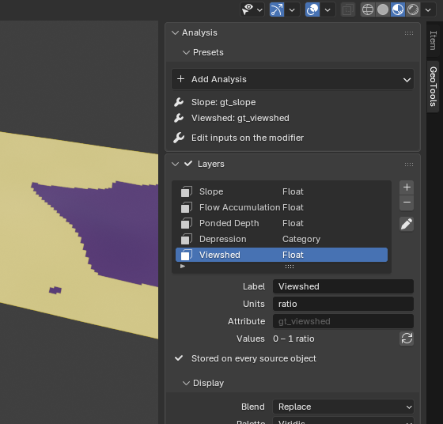
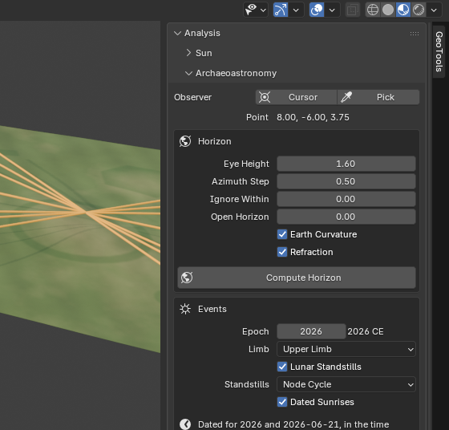
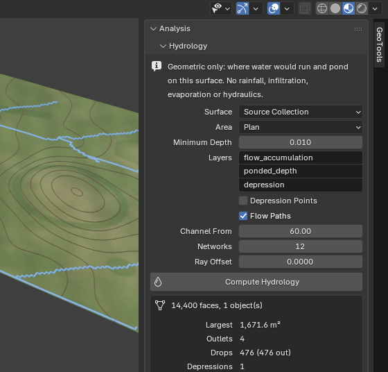
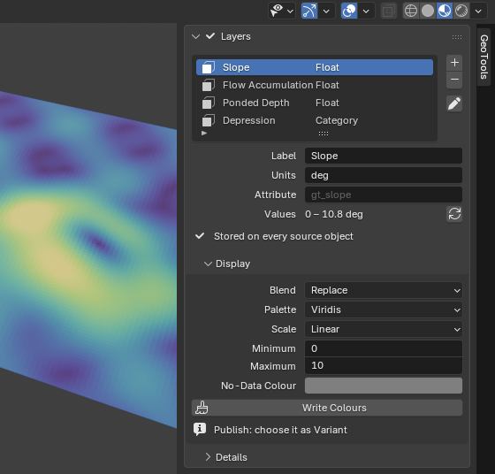
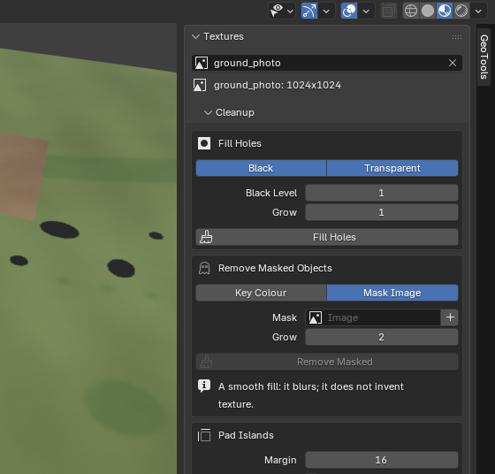
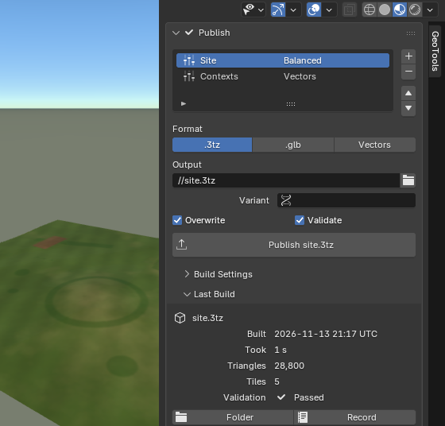

# GeoTools

<!-- Hero option B (designed banner): docs/assets/readme/hero-b.png (dark) or hero-b-light.png. Swap the src below to use it. -->

GeoTools brings GIS into Blender. Place a site in a real coordinate system,
bring in GeoJSON, GeoPackage and GeoTIFF, and analyse the full 3D mesh, not a
2.5D raster: terrain shape, archaeological visualisation, visibility, sun and
shadow, archaeoastronomy, hydrology, measurement, contours and sections.
Results are layers you can view, export as vectors or GLB metadata, and
publish as OGC 3D Tiles with
[rusty-tiles](https://github.com/BenDyson-Arch/rusty-tiles).

## What it does

<table>
<tr>
<td width="50%" valign="top">
 
<b>Georeference</b> 
Local, Anchor or CRS projects, with a searchable EPSG picker and Verify
Placement to see where the site lands.
<a href="docs/guide/projects.md">Guide</a>
</td>
<td width="50%" valign="top">
 
<b>Geo formats</b> 
GeoJSON, GeoPackage and GeoTIFF in, vectors out, all in the project's frame
and kept linked to their files.
<a href="docs/guide/geo-formats.md">Guide</a>
</td>
</tr>
<tr>
<td width="50%" valign="top">
 
<b>Terrain and visibility</b> 
Slope, aspect, curvature, TPI and TRI; local relief, sky-view factor and
openness; viewsheds, intervisibility and line of sight; volumes and
least-cost paths. Editable Geometry Nodes presets.
<a href="docs/guide/analysis.md#presets">Guide</a>
</td>
<td width="50%" valign="top">
 
<b>Sun and sky</b> 
Place the Sun for a date and place, map hours of sun, key a shadow study,
and find solstice, equinox and lunar standstill events on the real horizon.
<a href="docs/guide/analysis.md#archaeoastronomy">Guide</a>
</td>
</tr>
<tr>
<td width="50%" valign="top">
 
<b>Hydrology and measurement</b> 
Where water runs and ponds on the 3D surface, contours and sections, and
points, distances and areas in real coordinates.
<a href="docs/guide/analysis.md#hydrology">Guide</a>
</td>
<td width="50%" valign="top">
 
<b>Layers</b> 
Values per face, corner or texel, shown as colours and published as variant
tilesets.
<a href="docs/guide/layers.md">Guide</a>
</td>
</tr>
<tr>
<td width="50%" valign="top">
 
<b>Texture cleanup</b> 
Fill photogrammetry holes, remove masked objects, pad UV islands and balance
atlas pages.
<a href="docs/guide/textures.md">Guide</a>
</td>
<td width="50%" valign="top">
 
<b>Publish</b> 
Checks first, then a validated <code>.3tz</code> archive of 3D Tiles to
extract and serve to CesiumJS or any 3D Tiles viewer, or a GLB with metadata.
<a href="docs/guide/publish.md">Guide</a>
</td>
</tr>
</table>

You can also open published tiles back in Blender and trace them to their
source faces with
[Inspect Output](docs/guide/inspect-output.md).

## Install

You need Blender 5.2 LTS on Linux x64, Windows x64 or macOS arm64 (macOS 15 or
later). rusty-tiles and pyproj are bundled, so there is nothing else to
install.

1. Download the zip for your platform from the
   [releases](https://github.com/BenDyson-Arch/blender_geotools/releases):
   `geotools-<version>-linux_x64.zip`, `-windows_x64.zip` or
   `-macos_arm64.zip`.
2. In Blender, open **Edit > Preferences > Get Extensions** and choose
   **Install from Disk** (or drag the zip into the Blender window).
3. In the 3D Viewport, press **N** and select the **GeoTools** tab.

To build the zip yourself, see
[CONTRIBUTING.md](CONTRIBUTING.md#building).

The old 0.2 add-on lives on the
[`legacy-0.2`](https://github.com/BenDyson-Arch/blender_geotools/tree/legacy-0.2)
branch and is no longer developed.

## Documentation

Read the [user guide](docs/guide/README.md) here or on the docs site,
<https://bendyson-arch.github.io/blender_geotools/>. Start with
[Getting started](docs/guide/getting-started.md): it takes a synthetic demo
site from an empty Blender to a published tileset in about ten minutes.

## Working with BlenderGIS

GeoTools shares BlenderGIS's scene georeference keys, so both agree on where
the scene is, and it does not need BlenderGIS:
[Working alongside BlenderGIS](docs/guide/blendergis.md).

## Contributing

See [CONTRIBUTING.md](CONTRIBUTING.md) and the plan in
[docs/ROADMAP.md](docs/ROADMAP.md).

## Licence

GPL-3.0-or-later. See [LICENSE](LICENSE).
