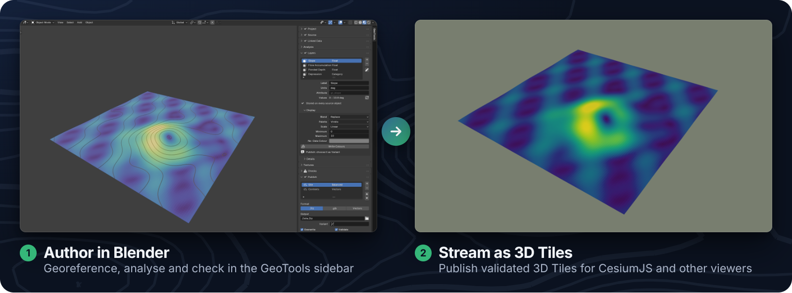
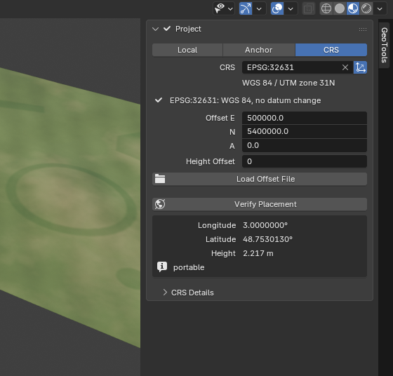
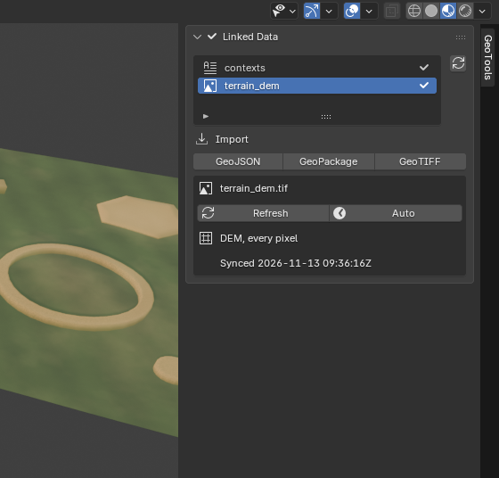
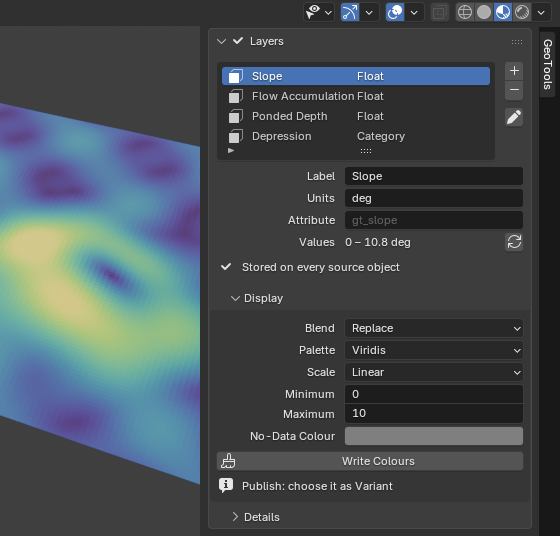
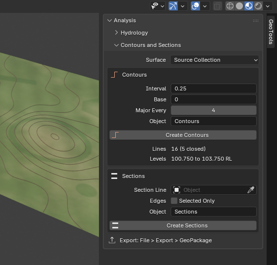
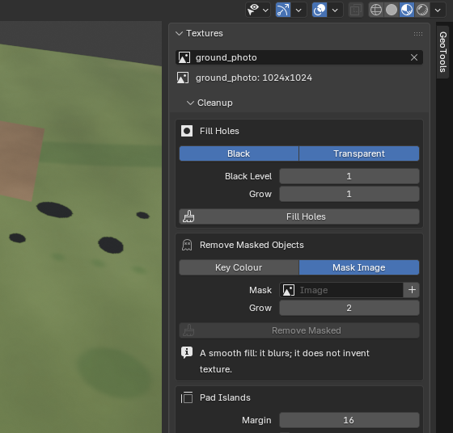
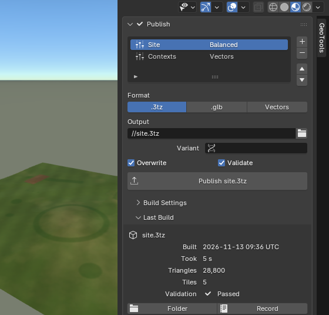

# GeoTools

<!-- Hero option B (designed banner): assets/readme/hero-b.png (dark) or hero-b-light.png. -->

GeoTools is a Blender 5.2 extension that places a site on Earth, analyses it,
and publishes it as OGC 3D Tiles with
[rusty-tiles](https://github.com/BenDyson-Arch/rusty-tiles). Everything is on
the **GeoTools** tab of the 3D Viewport sidebar, and the result is a standard
`.3tz` archive of OGC 3D Tiles: extract and serve it to stream it in CesiumJS or
any 3D Tiles viewer ([how](guide/publish.md#viewing-a-3tz-elsewhere)).

[Get started](guide/getting-started.md){ .md-button .md-button--primary }
[Read the user guide](guide/README.md){ .md-button }

## What it does

-   

    **Georeference**

    Local, Anchor or CRS projects, with a searchable EPSG picker and Verify
    Placement to see where the site lands.

    [:octicons-arrow-right-24: Georeference and projects](guide/projects.md)

-   

    **Geo formats**

    GeoJSON, GeoPackage and GeoTIFF in, vectors out, all in the project's
    frame and kept linked to their files.

    [:octicons-arrow-right-24: Geo formats](guide/geo-formats.md)

-   

    **Layers**

    Values per face, corner or texel, shown as colours and published as
    variant tilesets.

    [:octicons-arrow-right-24: Layers and bakes](guide/layers.md)

-   

    **Analysis**

    Sun and shadow studies, archaeoastronomy, hydrology, contours, sections
    and editable Geometry Nodes presets.

    [:octicons-arrow-right-24: Analysis](guide/analysis.md)

-   

    **Texture cleanup**

    Fill photogrammetry holes, remove masked objects, pad UV islands and
    balance atlas pages.

    [:octicons-arrow-right-24: Texture cleanup](guide/textures.md)

-   

    **Publish**

    Checks first, then a validated `.3tz` archive of 3D Tiles to extract and
    serve to CesiumJS or any 3D Tiles viewer, or a GLB with metadata.

    [:octicons-arrow-right-24: Checks and publishing](guide/publish.md)

## Also in GeoTools

-   **Inspect output**

    Open published tiles back in Blender and trace them to their source
    faces.

    [:octicons-arrow-right-24: Inspecting output](guide/inspect-output.md)

-   **GLB with metadata**

    One standard glTF file with the objects, layers and georeference as
    metadata.

    [:octicons-arrow-right-24: GLB with metadata](guide/glb-metadata.md)

-   **Working with BlenderGIS**

    GeoTools shares BlenderGIS's scene georeference keys, and does not need
    BlenderGIS.

    [:octicons-arrow-right-24: Working alongside BlenderGIS](guide/blendergis.md)

-   **Analysis presets**

    Every Geometry Nodes preset with its formula, inputs, accuracy and
    timing.

    [:octicons-arrow-right-24: Analysis presets](analysis-presets.md)

## Install

You need Blender 5.2 LTS on Linux x64, Windows x64 or macOS arm64 (macOS 15 or
later). rusty-tiles and pyproj are bundled, so there is nothing else to
install.

1. Download the zip for your platform from the
   [releases](https://github.com/BenDyson-Arch/blender_geotools/releases):
   `geotools-<version>-linux_x64.zip`, `-windows_x64.zip` or
   `-macos_arm64.zip`.
2. In Blender, open **Edit > Preferences > Get Extensions** and choose
   **Install from Disk** (or drag the zip into the Blender window).
3. In the 3D Viewport, press **N** and select the **GeoTools** tab.

Then follow [Getting started](guide/getting-started.md): it takes a synthetic
demo site from an empty Blender to a published tileset in about ten minutes.

## Project

- [Contributing](../CONTRIBUTING.md), the [changelog](../CHANGELOG.md) and the
  [roadmap](ROADMAP.md).
- GeoTools is licensed under GPL-3.0-or-later ([licence](../LICENSE)).
- The old 0.2 add-on lives on the
  [`legacy-0.2`](https://github.com/BenDyson-Arch/blender_geotools/tree/legacy-0.2)
  branch and is no longer developed.
